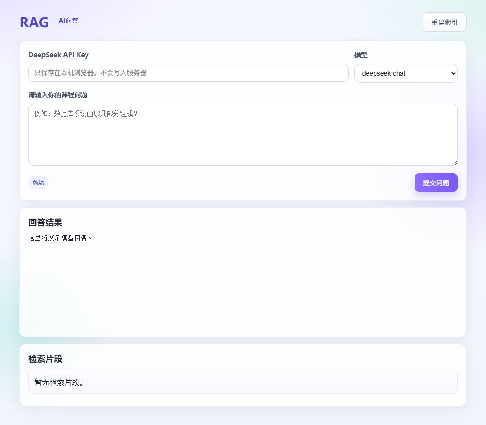
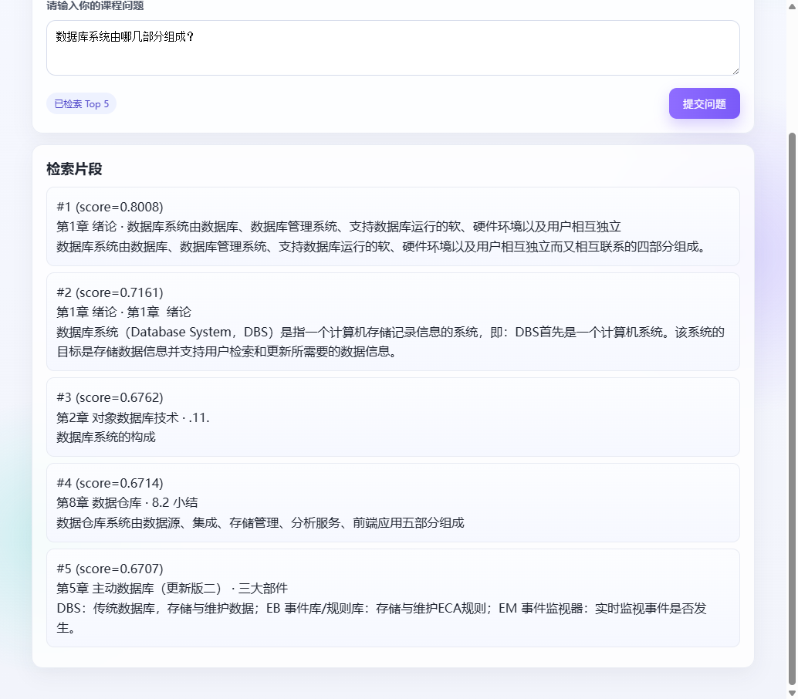

# 课程资料智能问答助手（RAG）

把《高级数据库技术》课件做成可检索的知识库。打开网页后填写自己的 DeepSeek API Key，输入课程问题，系统先从课件片段里找出最接近的内容，再让模型只根据这些资料回答。

## 项目功能

- 网页上填写 DeepSeek API Key，并在 `deepseek-chat` 和 `deepseek-reasoner` 之间选择模型。Key 只存在本机浏览器的 localStorage，不会写进服务器。
- 提问后，用本地嵌入模型把问题变成向量，在 1179 条课件片段里检索，取相似度最高的前 5 条。
- 距离大于 0.6 或短于 10 个字的片段不会进入提示词。保留下来的片段去重后，上下文控制在 1800 字以内。
- 模型按课程助教提示词回答。资料里没有相关内容时，回答「课程资料中不存在」。
- 页面同时展示回答和检索到的课件片段，包括章节、标题和相似度。
- 「重建索引」会清空现有向量，再把 `classdate/corpus.jsonl` 重新嵌入并写入。

语料文件是 `classdate/corpus.jsonl`。每一行是一个已经切好的课件片段，字段为 `doc_id`、`chapter`、`title`、`text`，内容覆盖第 1 章到第 10 章，共 1179 条。入库时把章节、标题和正文拼成一段文本再做向量，这样章节名也会参与匹配。

## 依赖与配置环境

在 Windows 上使用 Conda 环境，Python 3.12。前端需要 Node.js 和 npm。

```powershell
conda create -n RAG python=3.12 -y
conda activate RAG
pip install torch --index-url https://download.pytorch.org/whl/cpu
pip install -i https://pypi.tuna.tsinghua.edu.cn/simple -r requirements.txt
```

`requirements.txt` 中的直接依赖：

- fastapi、uvicorn：后端接口
- pymilvus、python-dotenv、pandas
- llama-index、llama-index-embeddings-huggingface、llama-index-llms-dashscope
- openai：调用 DeepSeek 的兼容接口

嵌入模型是 BAAI/bge-m3，向量维度 1024，约 2.2GB，不放进 Git 仓库。首次使用前下载到项目内的 `models/BAAI/bge-m3`：

```powershell
$env:HF_ENDPOINT = "https://hf-mirror.com"
python -c "from huggingface_hub import snapshot_download; snapshot_download(repo_id='BAAI/bge-m3', local_dir=r'models/BAAI/bge-m3', ignore_patterns=['onnx/*','*.onnx','imgs/*'])"
```

仓库里已经带有建好的向量文件 `ragPromptEnhancer.db.json`。本机是 Windows，不能使用 Milvus Lite，所以向量存在这个 JSON 文件里。模型就位且条数与 JSONL 一致时，启动后端不会重新嵌入。

前端：

```powershell
cd medical/frontend
npm install
npm run dev
```

另开一个终端，在项目根目录启动后端：

```powershell
python medical/backend/api.py
```

- 网页：http://localhost:5173/
- 接口：http://127.0.0.1:8080
- `POST /api/ask`：提问
- `POST /api/rebuild-index`：重建索引

根目录 `.env` 只给课程示例里的通义千问客户端占位。课程问答使用的是网页里填写的 DeepSeek API Key。

## 开发过程

采用了 Python + LlamaIndex 架构开发，以下按 LlamaIndex 的 RAG 流程梳理开发过程：
1、确立技术路径：
为什么采用 LlamaIndex，而不用 LangChain？LangChain 覆盖对话、工具和代理等整类大模型应用，LlamaIndex 更集中在读文档、切块、嵌入、索引和查询这一条检索链路上。它提供 SimpleDirectoryReader 这类标准组件，读取目录文档时不必为每种文件单独写解析代码，课程实验里就用它加载文档。
开发工具使用 Cursor，让grok4.7到github里面找做好的项目参考，再筛选一个合适的导入，让cursor配合grok4.7完美解决依赖问题，grok4.7目前上海有服务器直接连接，可以自动找镜像网站下载依赖，而且会自动检查，比传统pycharm里面pip或者conda手动下包快很多，手动下包总是失败非常慢
为什么用grok4.7，而不用grok4.6？在日常对话和文档写作方面grok4.6的确更加强大，但对于幻觉的约束和驾驭明显不行，容易把项目大幅度乱改，删了重写，grok4.7变得非常谨慎，不会乱换解决方案，尽量按照原本函数走
2、数据获取：课程资料里面的ragbasic-master\ragbasic-master\classdate\corpus.jsonl，但其实太短了，现在随便一个模型都是几十万上下文，可以直接塞进去，可以从modelscope或者huggingface里面下一个几百万字的数据集
3、数据清洗/简化：采用正则表达式去掉了json串里面的各种符号，跳过空行，去掉 doc_id、chapter、title、text 的首尾空白，丢掉正文为空的行。
4、数据分块：一行就是一个 chunk，入库前只把章节、标题和正文用换行拼成一段文本，让章节名也能参与检索。
5、数据入库，数据检索：嵌入模型使用本地的 BAAI/bge-m3，通过 LlamaIndex 的 HuggingFaceEmbedding 调用，向量维度 1024，每批 32 条写入。当前系统是 Windows，不能使用 Milvus Lite，向量保存在项目内的 ragPromptEnhancer.db.json。
检索采用余弦距离，计算方式是 1 减去余弦相似度。bge 系列比较的是两段文本在语义方向上是否接近，余弦相似度适合这种比较；距离越小，表示问题与课件片段越接近。提问时用同一个模型把问题编成 1024 维向量，与全部 1179 条向量逐条计算，按距离从小到大取前 5 条。距离大于 0.6 的片段丢掉，短于 10 个字的片段丢掉，其余去重后拼成上下文，总长度控制在 1800 字以内。
6、生成提示词、LLM生成：检索到的课件片段和用户问题套进课程助教提示词。提示词要求只根据课程资料回答，分条说明，资料里没有相关内容时直接回答「课程资料中不存在」，不使用资料以外的知识。生成接口是 DeepSeek 的 OpenAI 兼容接口，模型为页面上选择的 deepseek-chat 或 deepseek-reasoner，API Key 由用户当次填写，不写入服务器。
7、web实现、前端部署：后端用 FastAPI，提供 POST /api/ask 和 POST /api/rebuild-index，运行在 http://127.0.0.1:8080。前端用 Vue 3 和 Vite，运行在 http://localhost:5173/。页面包含 API Key 输入框、模型选择、问题输入、回答结果和检索片段。API Key 保存在浏览器的 localStorage 中。本地启动后端和前端后，在网页中填写 DeepSeek API Key 即可提问。
8、截屏


TOP-K策略，显示相似度最高的前5个chunk


9、利用MCP直接上传github

## 运行截图

问答页面：



问题「数据库系统由哪几部分组成？」检索出的前 5 个课件片段。score 为 1 减去余弦距离，分数越高越接近：


